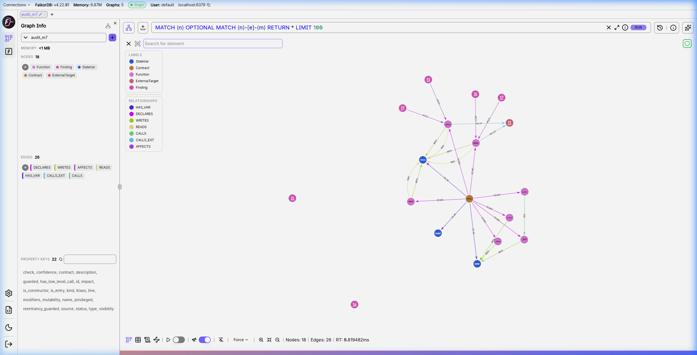

# 🛡️ Audit-Chain: Autonomous Graph Security Agent

> **Product in one line**: Upload a Solidity file; an autonomous agent uses MCP tools over a FalkorDB code graph to find attacker-reachable bugs, proves each finding with a formal multi-hop graph path, writes a patch, and mathematically proves the patch removed the path.

---

## 🏗️ Architecture

```
                 +-------------------+
                 |   Solidity File   |
                 +---------+---------+
                           |
                           v
                   +---------------+
                   | Slither & AST |
                   +-------+-------+
                           |
                           v
               +-----------------------+
               | Graph Ingestion Engine|
               +-----------+-----------+
                           |
                           v
              +-------------------------+
              |   FalkorDB Code Graph   |
              | (Functions, Calls, Vars)|
              +------------+------------+
                           |
                           v
               +-----------------------+
               |   9 FastMCP Graph     |
               |      Query Tools      |
               +-----------+-----------+
                           |
            +--------------+--------------+
            |                             |
            v                             v
  +-------------------+         +-------------------+
  | Deterministic     |         | Autonomous LLM    |
  | Offline Reporter  |         | Security Agent    |
  +---------+---------+         +---------+---------+
            |                             |
            +--------------+--------------+
                           |
                           v
              +-------------------------+
              |    🔬 Verifier Gate     |
              | (No Graph Path = Reject)|
              +------------+------------+
                           |
                           v
              +-------------------------+
              | Verified Security Report|
              +------------+------------+
                           |
                           v
              +-------------------------+
              |  Remediation Patcher    |
              |   & Proof-of-Removal    |
              +------------+------------+
                           |
                           v
              +-------------------------+
              |  Streamlit UI & Score   |
              +-------------------------+
```

---

## 🎯 Track Focus Areas & Differentiators

| Track Focus Area | Implementation in Audit-Chain |
|---|---|
| **Multi-hop reasoning** | `entry_paths_to` follows up to 6 `CALLS` hops across internal and external contract dispatches (e.g. `handOver -> _grant -> owner` in `m2` and `m7`). |
| **Graph queries & algorithms as agent tools** | 9 MCP tools including PageRank centrality hotspots (`CALL algo.pageRank` with NetworkX fallback), attack-surface scoring, and blast radius. |
| **Tool selection through MCP** | FastMCP server discovers schema and lets the agent autonomously choose its inspection and reachability verification sequence. |
| **Actions based on graph state** | Automated patch generation with re-ingestion and formal proof of path elimination and score reduction. |
| **Explainable results** | Every single finding includes its exact call path, Cypher proof, and verifier gate confirmation. |

### Differentiators:
1. **Verifier Gate**: Zero halluncinations. If a model hallucinates a path or cannot prove call reachability from an unguarded entry, it is rejected.
2. **Reachability-Weighted Ranking**: Findings are prioritized by attacker reachability, PageRank centrality, and detector confidence.
3. **Patch-and-Prove**: Automated remediation engine verifies that the patch compiles, eliminates the vulnerability, preserves function signatures, and decreases the attack surface score.
4. **Adversarial Red-Team / Blue-Team Harness**: Ground-truth scoreboard tracking recall, precision, path accuracy, and patch success rate.
5. **Audit Memory Graph**: Past successful patches are stored in `audit_memory` (`FIXED_BY` edges) to feed verified remediation hints back to subsequent audits.

---

## ⚡ Quickstart

```bash
# 1. Start FalkorDB
docker compose up -d

# 2. Install dependencies & activate venv
python -m venv .venv
source .venv/bin/activate  # Or .venv\Scripts\activate on Windows
pip install -r requirements.txt
solc-select install 0.8.19
solc-select use 0.8.19

# 3. Run Ground-Truth Adversarial Harness (Round 0)
python -m src.evaluate --round 0 --mode offline --patch oracle

# 4. Launch Interactive Web Dashboard
streamlit run app.py
```

---

## 📊 Evaluation Scoreboard

The red-team/blue-team evaluation harness scores the system across mutated and held-out contracts:

| Round | Mode | Patch Engine | Recall | Precision | Path Accuracy | Patch Success | Mean Tools | Mean Seconds |
|---|---|---|---|---|---|---|---|---|
| **Round 0** (clean, m1-m7) | offline | oracle | **1.00** | **1.00** | **1.00** | **1.00** | 4.5 | 1.24s |
| **Round 2** (held-out h1-h4) | offline | oracle | **1.00** | **1.00** | **1.00** | **1.00** | 4.0 | 1.14s |
| **Round 3** (m7 3x consistency) | offline | oracle | **1.00** | **1.00** | **1.00** | **1.00** | 7.0 | 1.22s |

---

## 📸 FalkorDB Call Graph Visualization



---

## ⚠️ Honest Limitations

1. **Scope**: Analyzes single-file Solidity 0.8.19 contracts. Multi-file imports and cross-contract inter-file links are out of scope.
2. **Detectors**: Reentrancy and unchecked low-level calls are seeded by Slither detectors, while privileged write paths, multi-hop reachability, blast radius, and centrality are derived purely by graph algorithms.
3. **Guard Heuristics**: Function protection is detected via modifier regex and conditional `msg.sender` state reads. Complex inline permission contracts require formal verification.
4. **Graph Centrality**: PageRank values are most informative on contracts with substantial call graphs (>10 functions).

---

## 🚀 Future Work
- Multi-file compilation and inter-contract dynamic proxy call resolution.
- Dynamic symbolic execution and fuzzing harness integration for edge-case validation.
- ERC20 / ERC721 invariant graph models.
- Support for Arbitrum, Base, and EVM L2 opcode inspection.
